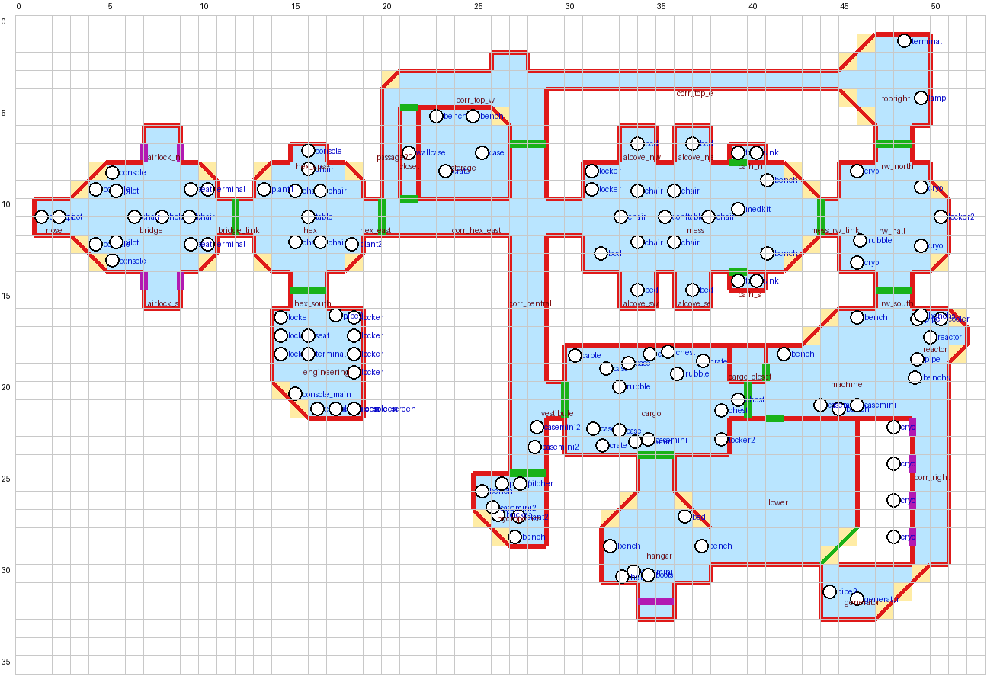

# TaleSpire Slabs & Boards

## Grasshopper – begehbares Raumschiff (Death in Space Deckplan)

Der komplette Deckplan der **Grasshopper** (aus *Death in Space*, Vorlage: `Grasshopper-PrinterFriendly-A3.pdf`)
als TaleSpire-Slab, 1 Planquadrat = 1 TaleSpire-Einheit, 53 × 36 Felder. Alle Räume sind begehbar,
Türen sitzen an den Stellen des Plans, die Möbel sind als Props gesetzt, und es gibt eine separate
Deckenebene, die man mit TaleSpires Höhen-Clipping (Hide Volumes / Clipping-Ebene für GM und Spieler) ein- und
ausblenden kann.



### Dateien

| Datei | Inhalt | Assets |
|---|---|---|
| `grasshopper/grasshopper_full.slab.txt` | **Alles** (Boden, Wände, Türen, Props, Decke) | 1515 |
| `grasshopper/grasshopper_no_ceiling.slab.txt` | Boden + Wände + Türen + Props, ohne Decke | 818 |
| `grasshopper/grasshopper_layer1_floor.slab.txt` | nur Boden | 240 |
| `grasshopper/grasshopper_layer2_walls_doors.slab.txt` | nur Wände, Türen, Luken | 459 |
| `grasshopper/grasshopper_layer3_props.slab.txt` | nur Möbel/Props | 121 |
| `grasshopper/grasshopper_layer4_ceiling.slab.txt` | nur Decke (auf Höhe 2.0) | 699 |

Alle Slabs liegen weit unter dem TaleSpire-Limit von 30 KB (komprimiert); der volle Slab hat rund 7 KB Text.

### Einfügen in TaleSpire

1. Den kompletten Inhalt einer `.slab.txt` kopieren (inklusive der ``` am Anfang und Ende, TaleSpire akzeptiert beides).
2. In TaleSpire im Baumodus **Strg+V** drücken, Slab platzieren, mit Klick bestätigen.
3. Empfohlen: zuerst `grasshopper_no_ceiling`, dann `grasshopper_layer4_ceiling` **an derselben Cursorposition und Höhe**
   einfügen. Jeder Teil-Slab enthält dazu eine einzelne „Anker“-Bodenkachel an der gemeinsamen Südwest-Ecke
   (links unten außerhalb des Schiffs), damit alle Ebenen exakt übereinander landen. Die Ankerkachel danach löschen.
4. Decke ausblenden: in TaleSpire die Clipping-Höhe (Mausrad + Taste für Höhenschnitt, bzw. Hide Volumes) knapp
   unter 2.0 setzen, dann sieht man von oben in die Räume.

### Räume (Planbezeichnung → Slab)

Brücke mit Bug-Pilotenstation, zwei gebogenen Konsolenbänken und Holo-Tisch, Nord- und Süd-Luftschleuse mit
Außenluken; runder Beobachtungs-/Besprechungsraum mit Sechskanttisch und Apsis-Konsole; Maschinenraum darunter
(Spinde, Konsolenreihe, Diagonalkonsole); Lager mit Bänken; Wandschrank-Gang; oberer Korridor mit Bogenfenster;
Zentralkorridor mit Schotttür; Messe mit Konferenztisch, vier Kojen-Nischen und zwei Bädern; Steuerbord-Halle mit
vier Kryo-Kapseln; oberer Steuerbord-Block mit Liftplattform (leuchtender Boden) und Terminal; Maschinen-/Reaktorraum
mit Rohrleitungen; Frachtraum mit Kisten und Vorraum; Hydroponik mit Pflanzen; Hangar-Trichter mit Bodenluftschleuse;
unterer Raum mit Diagonal-Luke zum Generatorraum; Steuerbord-Korridor mit vier Rettungskapseln (außen am Rumpf,
Luken in der Wand).

### Annahmen und Stellschrauben

Die Slabs wurden ohne laufendes TaleSpire erzeugt. Das Binärformat ist gegen den offiziellen Referenz-Slab von
Bouncyrock byteidentisch geprüft, die Asset-IDs stammen aus TaleSpires eigener `index.json`. Nicht prüfbar waren die
genauen Modellmaße einzelner Assets. Dafür gibt es im Generator `tools/build_grasshopper.py` einen `CONFIG`-Block:

| Parameter | Bedeutung | Wenn in TaleSpire … |
|---|---|---|
| `WALL_T = 0.5` | angenommene Dicke der Wandkachel; Wände sitzen mittig auf den Wandlinien des Plans | … Wände um bis zu 0.25 neben der Bodenkante stehen → auf 0.25 oder 1.0 setzen |
| `WALL_ALONG_X_ROT = 0` | Drehung, bei der eine Wandkachel in x-Richtung verläuft | … alle Wände um 90° verdreht sind → auf 90 setzen |
| `DIAG_SIGN = -1` | Drehrichtung der 45°-Stücke | … die Diagonalwände spiegelverkehrt liegen → auf +1 setzen |
| `CEIL_Y = 2.0` | Höhe der Deckenebene (= Wandhöhe) | … die Decke schwebt oder in den Wänden steckt → anpassen |
| `PROP_Y = 0.0` | Höhe der Props über dem Bodenursprung | … Props im Boden versinken → 0.25 |
| `FACE` | welche Drehung „Blickrichtung Nord/Ost/Süd/West“ ist | … Stühle vom Tisch wegschauen → Werte um 180 drehen |

Danach einfach neu bauen:

```bash
python3 tools/build_grasshopper.py          # schreibt grasshopper/*.slab.txt
python3 tools/render_preview.py grasshopper/grasshopper_layout.png
```

Das Layout selbst (Räume als Zellmengen, Diagonalwände, Türen, Props) steht ebenfalls in `tools/build_grasshopper.py`
und lässt sich dort leicht ändern. `tools/slab_encoder.py` ist ein eigenständiger Encoder/Decoder für das
Slab-Format v2.

### Verwendete TaleSpire-Assets

| Schlüssel | Asset | UUID |
|---|---|---|
| `floor1` | space ship floor 1x1 | `36147fe1-3850-4662-a95e-1a56be8a14b4` |
| `floor2` | space ship floor 2x2 | `f095ea12-0e41-4a79-bf3b-9fa0b4400369` |
| `floorglow` | scifi floor glow 1x1 | `bd4507ba-85ba-4748-9142-b4857a8d8f89` |
| `hatchfloor` | space ship hatch horizontal 01 | `d58e27d0-3a41-4cb7-b6c8-c389ca16360b` |
| `wall` | space ship wall 1x1 basic | `09f8bec6-263d-4e96-bef5-eba63f27a114` |
| `door` | space ship door 1x1 | `f56d891a-ed49-4e6e-910e-81827e8eac37` |
| `door2` | space ship door double | `ae40e42f-2a00-4b99-97e1-c3d41baadc27` |
| `hatch` | space ship hatch Vertical 01 | `cac3888c-f04b-4da9-b0b3-db6e2d4b7b75` |
| `ceil` | space ship ceiling 1x1 | `c6619e55-11f4-4a20-b790-8970917c23ab` |
| `console` | sci fi console_  mid | `e9e64ec2-f473-46da-8267-107eaee37495` |
| `console_main` | Interstellar Console main | `a4857731-d982-4c81-95fa-50791b404b68` |
| `console_screen` | Interstellar Console base w screen | `52d56d1a-772a-47d9-97be-9c8f824f3e6f` |
| `terminal` | sci fi terminal | `9c4c8b19-379f-4c9e-9add-5bca941e0def` |
| `holotable` | Interstellar travel ON_OFF mech | `6e5804b7-381e-42b6-ae8d-3f2923025cab` |
| `pilot` | scifi chair pilot | `c928a5e6-c479-47d7-984c-4254f8780338` |
| `chair` | Interstellar chair | `9d4ea828-db15-48fc-8ebe-65734ed4c722` |
| `seat` | scifi seat terminal | `db61b415-d7bb-41bb-bfd1-d3fc2404c7e9` |
| `table` | scifi_table 01 A | `fd24e8e2-b4d4-4627-8573-4d06980db53e` |
| `conftable` | ConferenceTable_Office | `224d71a4-136f-431d-ae57-803d2de31a77` |
| `bed` | unit bed | `6e2c7f4e-c1f0-41a9-9e7b-24ec6076ec8b` |
| `cryo` | Cryo sleep lux | `3a5512c2-c266-44fc-8ba2-bf4e805745b0` |
| `locker` | Locker v1 | `e5446734-1eec-45f0-9aff-7cdddf6a459e` |
| `locker2` | Locker v2 | `4abd32cc-01b3-43ba-a748-222f8449c85d` |
| `bench` | bench locker large | `fe2fa079-9bba-4b07-a008-0c1ef85531c3` |
| `benchs` | bench locker small | `532dea3c-26df-48f7-9b8d-29fc1271db87` |
| `crate` | sci fi crate L 01 | `da125361-6adc-4d02-9805-bebf22dc340f` |
| `chest` | sci fi chest 02 | `84d38667-a961-4562-93b4-ec38aeb81c55` |
| `case` | case of supplies 01 | `abf5a41b-606e-4aa9-87ba-5964dbda73f8` |
| `casemini` | case of supplies 01 mini B | `721fea1e-ca6e-4b00-b32e-178883774c23` |
| `casemini2` | case of supplies 02 mini A | `6fe3a290-76ba-4f37-a484-77a520310643` |
| `cable` | Cable floor v1 | `26bc0db4-0c94-46ef-a64f-71e4b5a9a996` |
| `rubble` | Rubble pebbles spread out | `ac288dec-372b-4c7a-b70f-3a48115920ab` |
| `plant1` | Jungle plant 01 | `8fcd4b46-c6f3-4d50-b950-ef4557ffe7b4` |
| `plant2` | Jungle plant 02 | `ec794aa6-27da-4e8e-a122-4042a27f2c3f` |
| `pitcher` | Pitcher plant | `6e5af318-1737-4bf3-a35f-a3530f6fd2de` |
| `bucket` | grass bucket v1 | `0e3f8516-9ef8-46c2-a0f3-f9584c294c9f` |
| `toilet` | toilette residential | `d857a8c6-15b1-4102-8470-275574e8b2bc` |
| `sink` | sink residential | `6dd89e0f-27f6-45f8-85ff-799dc03d1e67` |
| `reactor` | Interstellar battery mech | `f3439bf0-9619-43fa-b516-768945d72a36` |
| `cooler` | battery cooler with battery | `1c380641-1d35-4bd2-9c31-51593cf83179` |
| `generator` | Interstellar egg mech | `3becaf94-92d4-425e-b870-8ce345a453a4` |
| `pipe` | machine pipe 01 | `4da1b40b-f0cf-44eb-8e38-aa742f21a0b8` |
| `pipe2` | scifi pipe medial 01 | `eb23f5c6-8646-4374-8505-aaecf8faaaa4` |
| `helm` | Astronaut helm | `c8250950-a9f6-4d74-986c-3943cc39d6d4` |
| `boots` | Astronaut boots | `28a6c1fd-edc2-4a71-8ca1-06e783da6c0e` |
| `medkit` | medkit chest 01 | `a341f6d2-f769-41b4-8afc-e9f9eecd0768` |
| `lamp` | Lamp Small | `bfc0bcfa-3df5-4890-9654-6138c27b6e13` |
| `wallcase` | wall case 01 | `d7c23080-3aa2-42bc-8e0a-392b406990b8` |

---

## English summary

The Death in Space **Grasshopper** deck plan as a walkable TaleSpire slab (1 square = 1 unit, 53 × 36 squares),
with floors, walls, doors, furniture props and a separate ceiling layer for TaleSpire's height clipping.
Paste `grasshopper/grasshopper_full.slab.txt` (or `grasshopper_no_ceiling` + `grasshopper_layer4_ceiling` at the same
cursor position; partial slabs carry one anchor tile at the shared minimum corner, delete it afterwards).
The generator `tools/build_grasshopper.py` holds the layout and a `CONFIG` block for the few conventions that could not
be verified without a running game (wall thickness/orientation, 45° rotation direction, ceiling height, prop facing).
